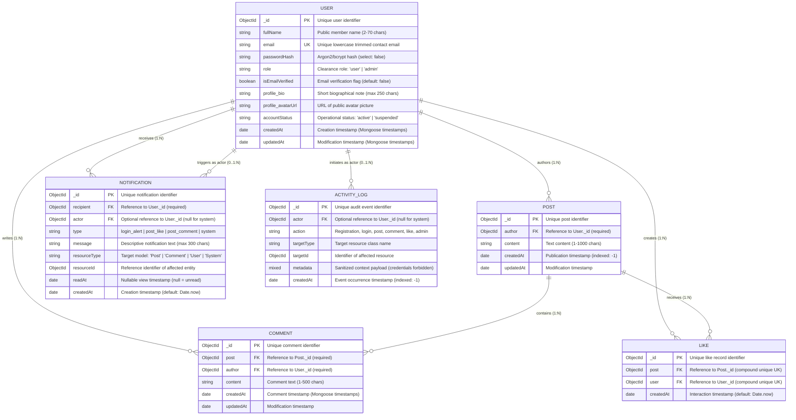

# Looply Entity-Relationship (ER) Diagram & Model Specifications

> **Project:** Looply ("Connect. Share. Express.")  
> **Database:** MongoDB / Mongoose ODM  
> **Phase Milestone:** Phase 3 — Backend Foundation and Database Design  

---

## 1. Visual Entity-Relationship Diagram

---

## 2. Collection Details & Field Inventories

### 2.1 User Entity (`users`)
- **Primary Key:** `_id` (`ObjectId`)
- **Unique Constraints:** `email` (`{ email: 1 }, { unique: true }`)
- **Security Protections:** `passwordHash` is excluded from default queries via `select: false`.
- **Enumerations:**
  - `role`: `'user'`, `'admin'` (default: `'user'`)
  - `accountStatus`: `'active'`, `'suspended'` (default: `'active'`)

### 2.2 Post Entity (`posts`)
- **Primary Key:** `_id` (`ObjectId`)
- **Foreign Keys:**
  - `author` &rarr; `User._id` (Required)
- **Validation:** `content` is required, trimmed, min 1, max 1000 characters.
- **Indexes:**
  - `{ createdAt: -1 }` (Global chronological feed)
  - `{ author: 1, createdAt: -1 }` (Author timeline)

### 2.3 Comment Entity (`comments`)
- **Primary Key:** `_id` (`ObjectId`)
- **Foreign Keys:**
  - `post` &rarr; `Post._id` (Required)
  - `author` &rarr; `User._id` (Required)
- **Validation:** `content` is required, trimmed, min 1, max 500 characters.
- **Indexes:**
  - `{ post: 1, createdAt: -1 }` (Post reply stream)

### 2.4 Like Entity (`likes`)
- **Primary Key:** `_id` (`ObjectId`)
- **Foreign Keys:**
  - `post` &rarr; `Post._id` (Required)
  - `user` &rarr; `User._id` (Required)
- **Unique Compound Index:**
  - `{ post: 1, user: 1 }` (`unique: true`) — Authoritative guarantee that a user cannot like the same post more than once.

### 2.5 Notification Entity (`notifications`)
- **Primary Key:** `_id` (`ObjectId`)
- **Foreign Keys:**
  - `recipient` &rarr; `User._id` (Required)
  - `actor` &rarr; `User._id` (Optional, nullable for system notices)
- **Enumerations:**
  - `type`: `'login_alert'`, `'post_like'`, `'post_comment'`, `'system'`
  - `resourceType`: `'Post'`, `'Comment'`, `'User'`, `'System'`, `null`
- **Indexes:**
  - `{ recipient: 1, createdAt: -1 }` (User notification inbox)
  - `{ recipient: 1, readAt: 1 }` (Fast unread count and filtering)

### 2.6 Activity Log Entity (`activitylogs`)
- **Primary Key:** `_id` (`ObjectId`)
- **Foreign Keys:**
  - `actor` &rarr; `User._id` (Optional, nullable for unauthenticated or system events)
- **Enumerations:**
  - `action`: `user_registration`, `successful_login`, `post_creation`, `post_update`, `post_deletion`, `comment_creation`, `like_creation`, `admin_action`
- **Security Validation:** `metadata` field validator enforces zero credential leakage (rejects passwords, password hashes, and JWT tokens).
- **Indexes:**
  - `{ createdAt: -1 }` (Platform chronological audit stream)
  - `{ actor: 1, createdAt: -1 }` (Actor audit history)

---

## 3. Database Design Decisions

1. **Why Normalized References over Embedded Subdocuments?**
   Social networks produce unbounded growth in comments and likes on popular posts. Embedding comments or likes inside a `Post` document would risk exceeding the 16MB MongoDB BSON document limit and cause significant document write locking and high memory churn. Normalized child collections scale to millions of interactions cleanly.

2. **Why a Dedicated `Like` Collection?**
   Using a separate collection with a unique compound index `{ post: 1, user: 1 }` prevents race conditions when concurrent like requests occur, guarantees idempotency at the database storage engine layer, and provides simple O(1) existence checks (`Like.exists({ post, user })`).

3. **Why Compound Indexing for Notifications?**
   Querying unread notifications requires filtering by `{ recipient: userId, readAt: null }`. An index on `{ recipient: 1, readAt: 1 }` permits MongoDB index-only scans, avoiding document fetching during badge count operations.

4. **Why Security by Schema Exclusion?**
   Declaring `passwordHash` with `select: false` ensures that even if a developer forgets to specify `.select('-passwordHash')` in a user query or controller, the password hash is never exposed to API consumers or client browsers.

